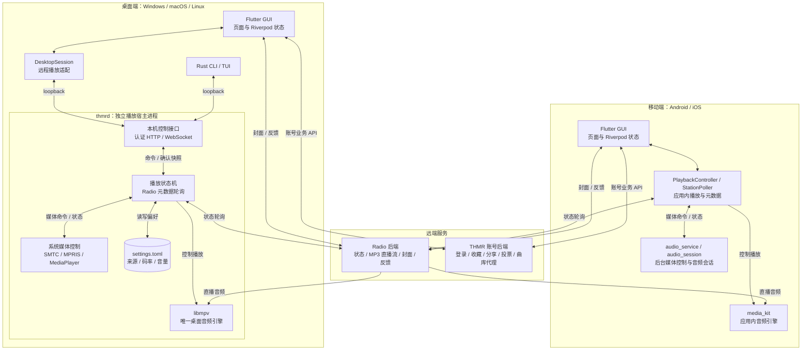

# 开发说明

## 架构与目录

桌面端由 `thmrd` 独占音频引擎、播放设置、Radio 元数据轮询和系统媒体会话。CLI、TUI 与 Flutter 通过[本机控制协议](../protocol/README.md)读取快照、发送命令。移动端保留应用内 `media_kit` 与 `audio_service`。



图中为默认播放路径，应用内诊断模式未展开。桌面 GUI 的音频与曲目信息来自宿主，封面、反馈和账号业务仍由 Flutter 直接请求；CLI/TUI 尚未桥接账号功能。`thmr-core` 为 Rust 各端提供共用协议、配置与宿主发现，不是额外进程。

| 目录 | 职责 |
| --- | --- |
| `crates/thmr-core` | 协议、配置、运行目录和宿主发现 |
| `crates/thmr-daemon` | libmpv 播放、直播状态机、Radio 轮询、HTTP/WebSocket 与原生媒体控制 |
| `crates/thmr-cli` | CLI、TUI 和 GUI 启动 |
| `lib/core/player` | Flutter 桌面会话适配、应用内播放器和频谱 |
| `lib/core/api`、`models`、`state` | 后端接口、数据模型和 Riverpod 状态 |
| `lib/core/platform`、`update` | 窗口、托盘、进程退出和更新安装 |
| `lib/features`、`shared` | 页面与共用组件 |
| 平台目录 | Windows/macOS/Linux/Android/iOS 工程 |
| `native` | 频谱采集、MP3 解码与固定版本的第三方源码及许可证 |
| `tool`、`test` | 构建/打包、冒烟脚本和测试夹具 |

桌面来源、码率和音量以宿主确认状态为准。主题、窗口和账号等界面设置由 Flutter 保存。共享宿主模式不创建第二个播放器、远端音频连接或系统媒体会话。暂停时切换来源/码率保持暂停；直播恢复时连接当前广播位置。

## 环境与源码运行

Flutter 版本与 `.github/workflows/build.yml` 保持一致，Rust 由 `rust-toolchain.toml` 固定。更新工具需要 Node.js 22+，辅助脚本使用 Python 3。Windows 需要 Visual Studio 桌面 C++ 工作负载；Linux 依赖见 [Linux 文档](LINUX.md)，macOS 需要 Xcode 与 CocoaPods。各平台客户端在对应系统构建。

```sh
flutter pub get
python tool/build_native.py --debug
```

将 `THMR_CLI_PATH` 设为下表中程序的绝对路径，再运行 `flutter run -d windows`、`flutter run -d macos` 或 `flutter run -d linux`：

| 平台 | 本地 debug CLI |
| --- | --- |
| Windows | `target/x86_64-pc-windows-msvc/debug/thmr.exe` |
| Linux | `target/debug/thmr` |
| macOS | `target/universal/debug/thmr` |

例如 Windows PowerShell：

```powershell
$env:THMR_CLI_PATH = "$PWD/target/x86_64-pc-windows-msvc/debug/thmr.exe"
flutter run -d windows
```

移动端使用 `flutter run -d <设备 ID>`。本地宿主还需可用的 libmpv；可通过 `THMR_MPV_LIBRARY` 指定库文件，或使用完整桌面包内的依赖。

`--dart-define=THMR_LOCAL_PLAYER=true` 仅用于诊断应用内播放器路径；正式桌面包默认连接共享宿主。

| 环境变量 | 用途 |
| --- | --- |
| `THMR_CLI_PATH` | Flutter 源码运行时指定 CLI |
| `THMR_GUI_PATH` | CLI 指定兼容 GUI |
| `THMR_MPV_LIBRARY` | 指定开发用 libmpv |
| `THMR_RUNTIME_DIR`、`THMR_CONFIG_DIR` | 隔离本机协议端点与配置目录 |
| `THMR_AUDIO_OUTPUT=null` | 宿主测试使用空音频输出 |

Flutter 后端地址等构建参数见[后端接口](API.md#配置)，更新参数见[更新与发布](AUTO_UPDATE.md)。桌面播放来源来自宿主设置，不使用 Flutter 的 Radio 构建参数。

## 构建与打包

先运行 `python tool/build_native.py` 构建 release 原生程序，再构建 Flutter、加入原生程序并生成终端包：

| 平台 | Flutter 构建 | 捆绑原生程序 |
| --- | --- | --- |
| Windows | `flutter build windows --release` | `python tool/package_desktop.py --platform windows --bundle build/windows/x64/runner/Release` |
| Linux | `flutter build linux --release` | `python tool/package_desktop.py --platform linux --bundle build/linux/x64/release/bundle` |
| macOS | `flutter build macos --release` | `python tool/package_desktop.py --platform macos --bundle build/macos/Build/Products/Release/THMR.app --stage-only` |

Windows 压缩完整的 `Release` 目录；Linux 保留完整 `bundle`；macOS 加入 helpers 后再运行 `bash tool/macos_distribution.sh` 签名并生成 DMG、ZIP 和终端包。macOS 构建包含 Intel 与 Apple Silicon 两种架构。

Android 使用 `python tool/patch_android_plugin.py` 适配当前 WebView 插件，再执行 `flutter build apk --release`。Windows 的插件构建补丁由 CMake 调用；这些兼容补丁仍被 CI 和当前依赖使用。

`pubspec.yaml` 是客户端版本与本地构建号的来源，Rust 在构建时读取它。CI 通过 `tool/resolve_version.py` 为各端解析同一版本，构建号为 `run number × 100 + run attempt`。显式覆盖版本时，需同时向 `build_native.py` 传 `--version`/`--build-number`，向 Flutter 传匹配的 `--build-name`/`--build-number` 与 `THMR_CLIENT_VERSION`。

`Build Clients` 手动构建可选 `all` 或单个平台。单平台、PR、fork 和普通开发分支构建只上传附件；上游 main 的完整构建生成预发布，稳定标签的完整构建生成正式 Release。原生 Rust 检查单独由 `Native host` 工作流运行。签名和发版步骤集中在[更新与发布](AUTO_UPDATE.md)。

生成物放在 `build/`、`target/` 或 Actions/Release，私有签名材料放在已忽略的目录中。不要将安装包、缓存、截图或一次性源码改写脚本提交到仓库。

## 验证

```sh
flutter analyze --no-pub
flutter test --no-pub
cargo fmt --all -- --check
cargo clippy --workspace --all-targets --locked -- -D warnings
cargo test --workspace --locked
python -m unittest discover -s tool -p 'test_*.py'
node --test tool/test_update_release.cjs
```

Python 更新器测试在隔离目录中用假应用覆盖安装成功与回滚，不替换正在使用的安装。需要 SDK/操作系统支持的测试按平台运行或跳过。

`tool/test_unified_host.py --bin-dir <原生程序目录>` 使用真实 libmpv、本地音频与空音频输出验证共享宿主、CLI 和 TUI。Linux 运行于私有 D-Bus 会话，Windows 需提供 libmpv。GUI 首帧、托盘、DMG/ZIP 与安装包运行库检查由各平台 CI 脚本执行；Linux 命令见 [Linux 文档](LINUX.md#验证)。

`tool/diagnostics_smoke.dart` 会访问真实诊断服务并将报告放在 `build/`；常规测试使用本地服务或模拟结果，不依赖公网。

## 支持范围

当前版本为开发预览。桌面 CLI/TUI 已支持免登录收听，账号登录/收藏尚未桥接到终端。Flutter 账号与收藏功能保留；Linux 登录只提供网页版入口。投票默认隐藏，由 `THMR_FEATURE_VOTE` 控制；评论/广场没有已接入的后端接口。

| 平台 | 当前边界 |
| --- | --- |
| Windows | 自绘标题栏、托盘、迷你播放器、系统媒体控制和系统输出频谱 |
| Linux | GTK 原生标题栏、托盘与 MPRIS；不提供迷你播放器；共享宿主模式频谱保持静态，避免重复拉流 |
| macOS | 原生标题栏与共享媒体宿主；托盘、迷你播放器和频谱原生实现待接入 |
| Android/iOS | 应用内播放与后台媒体控制；iOS 真机行为和发行仍需单独验证 |

Linux 应用内播放器的 MP3 频谱与测试代码保留，用于诊断；不代表共享宿主已支持流频谱。Windows 的 SMTC 插件及其运行时版本约束同样用于应用内诊断路径。

正式发行前需验证实际音频设备、系统媒体卡片/物理媒体键、睡眠唤醒、断网恢复和长时间收听；另需 Apple Silicon 实机、macOS Developer ID/公证、不同 Linux 桌面环境以及旧版真实升级/回滚验收。CI、空音频输出和 Xvfb 通过不能替代这些检查。
